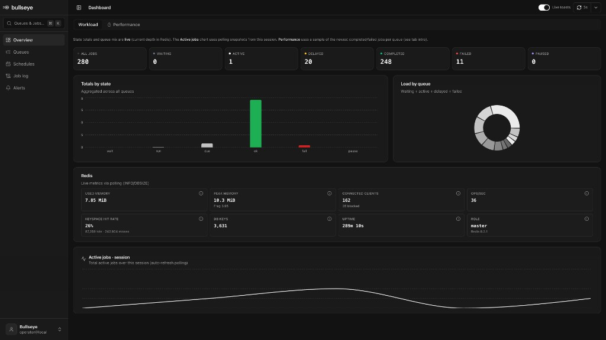
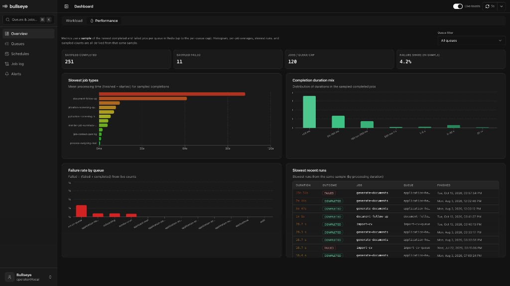
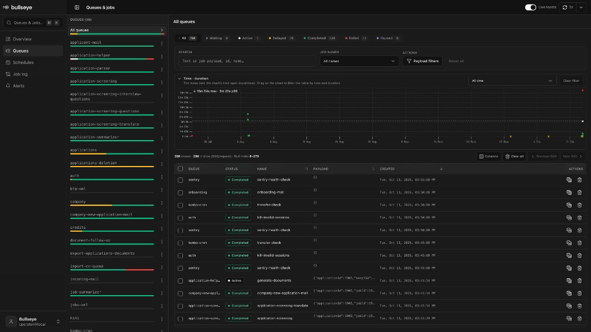
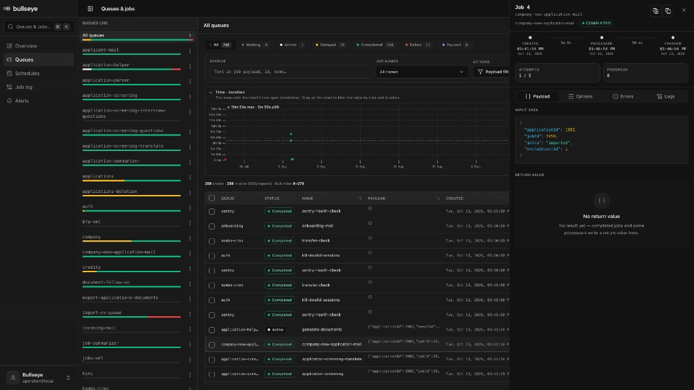
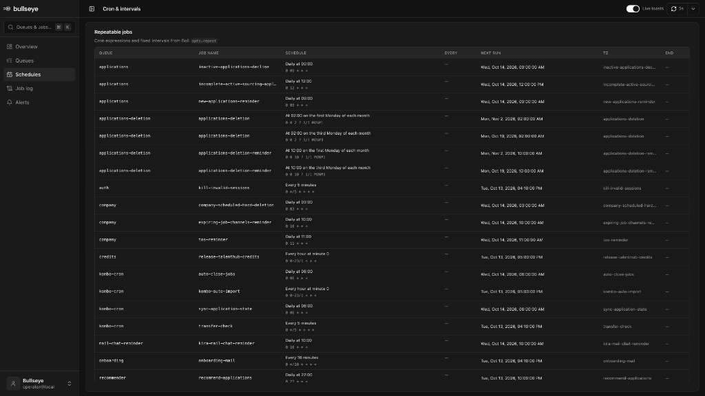
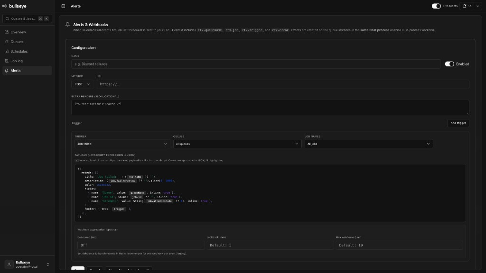
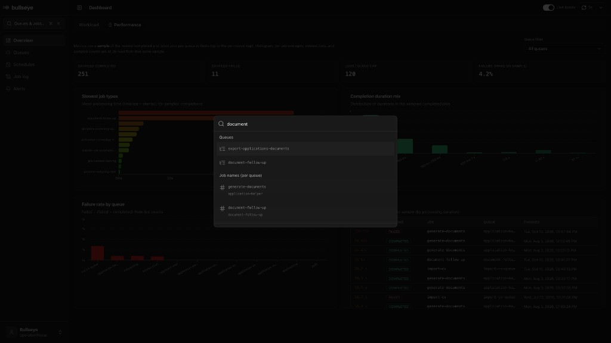

# nestjs-bullseye

**Open-source embedded queue dashboard for [Bull](https://github.com/OptimalBits/bull) and [BullMQ](https://docs.bullmq.io/) in NestJS (Express).**

One Nest module mounts a full SPA + REST API under a path you choose — no separate process, no extra Redis DB required for the UI itself. Optional **webhook alerts** and an embedded **MCP server** for AI tools (Cursor, Claude Desktop, …).

Inspired by tools like [Bull Board](https://github.com/felixmosh/bull-board) and [Taskforce.sh](https://taskforce.sh/) — Bullseye brings a similar queue-ops experience **into your NestJS app** as a self-hosted, MIT-licensed module you control.

[](https://www.npmjs.com/package/@catchhr/nestjs-bullseye)
[](./LICENSE)
[](https://nodejs.org/)
[](https://nestjs.com/)
[](https://docs.bullmq.io/)

> **v0.2.0** targets **NestJS 11–12** and **BullMQ 5.16+ / 6** (Job Schedulers). See [CHANGELOG](./CHANGELOG.md) for breaking changes.

---

## Screenshots

| Dashboard · Workload | Dashboard · Performance |
|----------------------|-------------------------|
|  |  |

| Queues & jobs | Job detail |
|---------------|------------|
|  |  |

| Schedules | Alerts |
|-----------|--------|
|  |  |

| Command menu (⌘K) |
|-------------------|
|  |

---

## Features

- **Dashboard** — Live depth tiles, active sampling, performance histogram, Redis metrics
- **Queues & jobs** — Filter by status, search, promote delayed jobs, retry failed, remove, add & duplicate
- **Time · duration heatmap** — Brush-select jobs by finish time (X) and duration (Y)
- **Schedules** — Bull repeatables and BullMQ **Job Schedulers** (cron / every)
- **Job log** — Cross-queue merged sample, sorted by start time
- **Alerts** — Threshold / event webhooks (config in Redis; optional JSON migration path)
- **Security** — HTTP Basic auth + custom Express middleware under `basePath`
- **MCP** — Optional Streamable HTTP endpoint for AI clients (`list_queues`, `get_job`, …)

---

## Requirements

| | Minimum |
|---|---|
| Node.js | **20.19+** or **22.12+** (NestJS 12) |
| NestJS | **11** or **12** (`@nestjs/common` / `@nestjs/core`) |
| HTTP adapter | **Express** (Fastify is not supported) |
| Queue backend | **Bull 4** *or* **BullMQ ≥ 5.16** (**6** recommended) |
| Redis | Same instance / prefix as your workers |

Install **either** classic Bull **or** BullMQ peers — you do not need both.

---

## Install

```bash
npm install @catchhr/nestjs-bullseye
```

### Bull (classic)

```bash
npm install @nestjs/bull bull ioredis express
```

### BullMQ

```bash
npm install bullmq ioredis express
# optional Nest integration:
# npm install @nestjs/bullmq
```

`@nestjs/bull` and `bull` are **optional** peers when you only use `backend: 'bullmq'`.

---

## Quick start

Import `BullseyeModule` **after** your queue module setup. Use the **same Redis connection and `prefix`** as your workers.

### Bull + `@nestjs/bull`

```typescript
import { Module } from '@nestjs/common';
import { BullModule } from '@nestjs/bull';
import { BullseyeModule } from '@catchhr/nestjs-bullseye';

@Module({
  imports: [
    BullModule.forRoot({
      redis: { host: 'localhost', port: 6379 },
      prefix: 'myapp',
    }),
    BullModule.registerQueue({ name: 'email' }),
    BullseyeModule.forRoot({
      basePath: '/queue-dashboard',
      redis: { host: 'localhost', port: 6379 },
      prefix: 'myapp',
      backend: 'bull', // default
      queueNames: ['email'], // optional allow-list
      basicAuth: {
        username: process.env.BULLSEYE_USER!,
        password: process.env.BULLSEYE_PASSWORD!,
      },
    }),
  ],
})
export class AppModule {}
```

Open: `http://localhost:3000/queue-dashboard`

### BullMQ

```typescript
BullseyeModule.forRoot({
  basePath: '/queue-dashboard',
  redis: { host: 'localhost', port: 6379 },
  prefix: 'myapp',
  backend: 'bullmq',
  queueNames: ['email'], // recommended in locked-down envs
}),
```

Queues are discovered via Nest DI (Bull) and/or Redis `SCAN` on `{prefix}:*:meta` when `autoDiscoverQueues` is enabled (default).

### Async config

```typescript
BullseyeModule.forRootAsync({
  imports: [ConfigModule],
  inject: [ConfigService],
  useFactory: (config: ConfigService) => ({
    basePath: '/queue-dashboard',
    redis: config.getOrThrow('REDIS_URL'),
    prefix: config.get('BULL_PREFIX'),
    backend: 'bullmq',
    basicAuth: {
      username: config.getOrThrow('BULLSEYE_USER'),
      password: config.getOrThrow('BULLSEYE_PASSWORD'),
    },
  }),
}),
```

---

## Module options

| Option | Type | Description |
|--------|------|-------------|
| `backend` | `'bull' \| 'bullmq'` | Queue implementation (default: `bull`). |
| `basePath` | `string` | Mount path **without** trailing slash (SPA + `/api/*`). |
| `faviconPath` | `string?` | Favicon served as `${basePath}/favicon.ico`. |
| `redis` | `string \| RedisOptions` | Must match workers. |
| `prefix` | `string?` | Redis key prefix (same as Bull / BullMQ). |
| `queueNames` | `string[]?` | Allow-list; omit to auto-discover. |
| `autoDiscoverQueues` | `boolean` | Default `true`. |
| `basicAuth` | `{ username, password } \| null` | HTTP Basic for UI + API under `basePath`. |
| `middleware` | Express middleware \| `null` | Runs after Basic auth. |
| `alertsStoragePath` | `string?` | Legacy JSON migration only; Redis is source of truth. |
| `alertsInstanceId` | `string?` | Separates alert keys in a shared Redis DB. |
| `operator` | profile \| `null` | Sidebar name / email / avatar (`GET …/api/ui-config`). |
| `mcp` | MCP options \| `null` | Embedded MCP server — see below. |

Exported DI token: **`BULLSEYE_OPTIONS`**.

---

## MCP (Cursor, Claude Desktop, …)

When `mcp` is set, Bullseye exposes a **Streamable HTTP** MCP endpoint at `${basePath}${mcp.path}` (default `${basePath}/mcp`). Auth is **Bearer** (`Authorization: Bearer <apiKey>`). The endpoint is **outside** HTTP Basic auth so automation clients do not need dashboard credentials.

```typescript
BullseyeModule.forRoot({
  basePath: '/queue-dashboard',
  redis: { host: 'localhost', port: 6379 },
  backend: 'bullmq',
  mcp: {
    path: '/mcp',
    apiKey: process.env.BULLSEYE_MCP_API_KEY!,
    readOnly: true, // default
  },
}),
```

**Cursor** (`.cursor/mcp.json` or `~/.cursor/mcp.json`):

```json
{
  "mcpServers": {
    "bullseye": {
      "url": "http://localhost:3000/queue-dashboard/mcp",
      "headers": {
        "Authorization": "Bearer ${env:BULLSEYE_MCP_API_KEY}"
      }
    }
  }
}
```

Read-only tools: `list_queues`, `list_jobs`, `get_job`, `get_job_log`, `get_runtime_stats`, `list_repeatable_jobs`, `get_redis_metrics`.

Do **not** expose MCP publicly. Use a long random `apiKey` and the same network controls as the dashboard.

---

## Security

Do **not** expose this dashboard on the public internet without protection. Prefer:

1. `basicAuth` and/or custom `middleware` (SSO, IP allow-list, …)
2. VPN / private network / reverse-proxy auth
3. Strong `mcp.apiKey` if MCP is enabled (MCP is **not** covered by Basic auth)

Alert webhooks fire from the **local** queue instance — typically only when workers run in the **same** Nest process as Bullseye.

---

## API overview

Mounted under `basePath`:

| Method | Path | Notes |
|--------|------|--------|
| `GET` | `/api/ui-config` | Operator sidebar profile |
| `GET` | `/api/queues` | Queue summaries + counts |
| `GET` | `/api/repeatable-jobs` | Schedules / Job Schedulers |
| `GET` | `/api/stats/job-runtime` | Duration samples / histogram |
| `GET` | `/api/job-log` | Cross-queue log |
| `GET` | `/api/redis/metrics` | Redis `INFO` snapshot |
| `GET/POST` | `/api/alerts` | Alert CRUD |
| `PUT/DELETE` | `/api/alerts/:id` | |
| `GET` | `/api/queues/:queueName/jobs` | List / merge statuses |
| `GET` | `/api/queues/:queueName/jobs/:jobId` | Detail + logs |
| `POST` | `/api/queues/:queueName/jobs` | Enqueue |
| `POST` | `…/jobs/:jobId/promote` | Delayed → waiting |
| `POST` | `…/jobs/:jobId/retry` | Failed → retry |
| `POST` | `…/jobs/:jobId/duplicate` | Clone with overrides |
| `DELETE` | `…/jobs/:jobId` | Remove |
| `POST` | `…/pause` · `/resume` · `/empty` | Queue controls |

---

## BullMQ 6 notes

BullMQ 6 **removed** legacy repeatable APIs (`getRepeatableJobs`, `repeat` on `queue.add`, …) in favor of **Job Schedulers** (`upsertJobScheduler`, `getJobSchedulers`, `removeJobScheduler`).

Bullseye’s Schedules view uses `getJobSchedulers()` (with a fallback to `getRepeatableJobs()` on older BullMQ 5.x). If you upgrade producers/workers to BullMQ 6, migrate scheduled jobs first — see the [official migration guide](https://docs.bullmq.io/guide/migrations/migrate-from-v5-to-v6) and this package’s [CHANGELOG](./CHANGELOG.md).

Also in BullMQ 6: the **`paused` job state is gone**. Pausing a queue leaves jobs in **waiting**; use the queue’s `isPaused` flag (shown in the UI) rather than a separate paused job list.

---

## Development

Maintainer build / publish / MCP test notes: **[DEVELOPMENT.md](./DEVELOPMENT.md)**.

```bash
npm install
npm run build          # frontend → public/ + library → dist/
cd frontend && npm run dev   # Vite SPA only
```

---

## Contributing

Issues and PRs are welcome. Please:

1. Open an issue for larger changes
2. Keep diffs focused (library *or* SPA unless they must ship together)
3. Run `npm run build` before opening a PR
4. Document user-facing changes in `CHANGELOG.md`

---

## Inspiration & related projects

Bullseye is **open source** ([MIT](./LICENSE)) and was inspired by the broader Bull / BullMQ ecosystem:

| Project | What it is |
|---------|------------|
| [Bull Board](https://github.com/felixmosh/bull-board) | Popular open-source UI to inspect Bull / BullMQ queues |
| [Taskforce.sh](https://taskforce.sh/) | Professional hosted dashboard (by the BullMQ creators) with monitoring, teams, alerts, and MCP |

Those projects set the bar for what “good” queue visibility looks like. Bullseye aims at a complementary niche: **embed the dashboard in NestJS**, keep data in **your** Redis, and ship extras like webhook alerts and an optional MCP endpoint — without a separate SaaS or sidecar process.

Not affiliated with Bull Board or Taskforce.sh; names and logos belong to their respective owners.

---

## License

[MIT](./LICENSE) — free to use, modify, and distribute.
